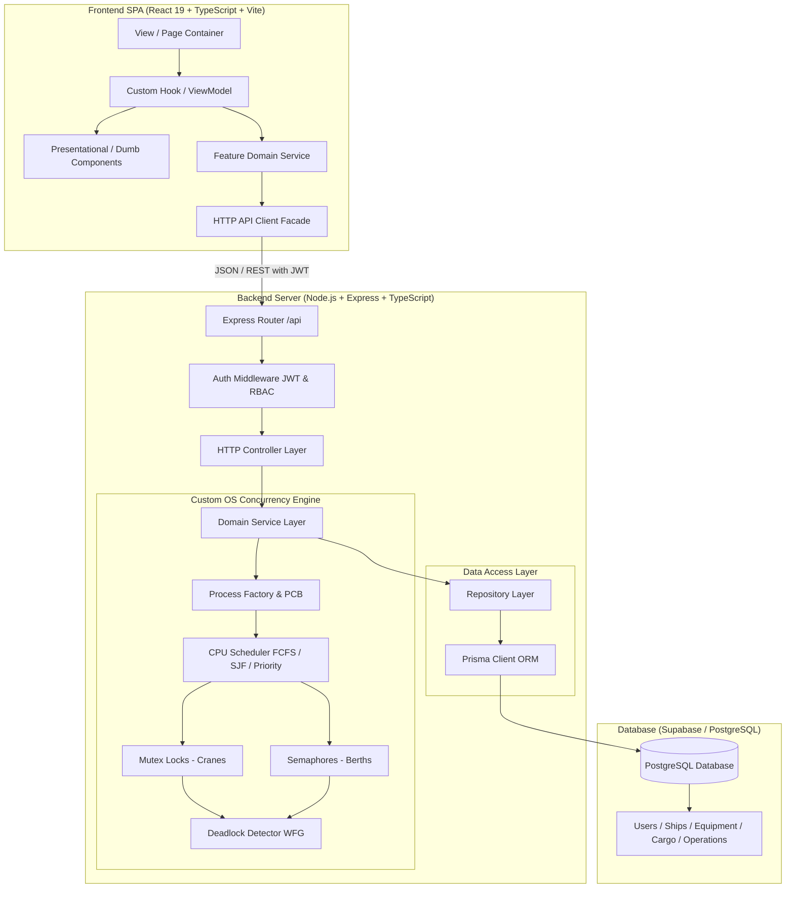
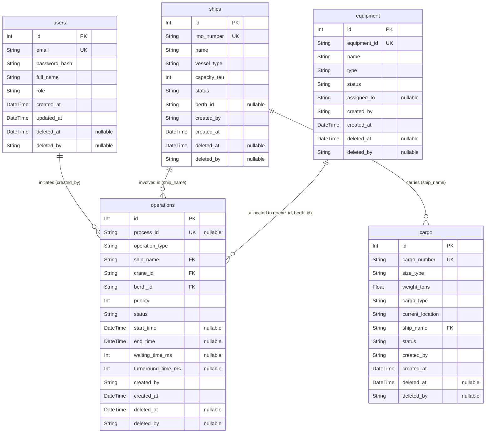

<div align="center">
  

# ⚓ PortFlow — Smart Maritime Port Management System

**An Intelligent Full-Stack Maritime Operations Suite with Custom OS & DBMS Simulation Engines**

[](https://react.dev/)
[](https://nodejs.org/)
[](https://supabase.com/)
[](https://www.prisma.io/)
[](#-architecture--data-flow)
[](#-license)

</div>

---

## 📑 Table of Contents

- [🌊 Overview](#-overview)
- [🏛️ System Architecture & LLD Design](#️-system-architecture--lld-design)
- [🧠 Operating System (OS) Concepts](#-operating-system-os-concepts)
- [💾 Database (DBMS) Concepts](#-database-dbms-concepts)
- [✨ User Roles & Core Features](#-user-roles--core-features)
- [📂 Repository Structure](#-repository-structure)
- [🚀 Quick Start & Installation](#-quick-start--installation)
- [🧪 Testing & Load Testing](#-testing--load-testing)
- [🔑 Test Credentials](#-test-credentials)
- [📈 Project Milestones & Roadmap](#-project-milestones--roadmap)
- [📚 Detailed Sub-Guides](#-detailed-sub-guides)
- [📄 License](#-license)

---

## 🌊 Overview

Modern commercial ports operate 24/7, coordinating massive container ships, heavy cargo inventory, and limited physical infrastructure (berths and cranes). **PortFlow** bridges maritime logistics with fundamental computer science principles:

1. **Custom OS Simulation Kernel**: Treats port jobs as operating system **processes**, manages scarce crane access through **Mutex locks**, models berth parking capacity using counting **Semaphores**, and dynamically schedules waiting jobs via selectable algorithms (**FCFS, SJF, Priority**).
2. **Robust Database Layer**: Powered by PostgreSQL and Prisma ORM, utilizing 3NF relational normalization, foreign-key constraints, soft-delete audit trails, and transactional integrity.
3. **Enterprise Low-Level Design (LLD)**: Built with clean separation of responsibilities on both backend (Controllers $\rightarrow$ Services $\rightarrow$ Repositories $\rightarrow$ Models/Interfaces) and frontend (Smart Containers $\rightarrow$ ViewModels/Custom Hooks $\rightarrow$ Presentational Components).
4. **Interactive Operations Terminal**: A modern React 19 web suite featuring a unified **Terminal Operator Ground Portal**.

---

## 🏛️ System Architecture & LLD Design

PortFlow utilizes a multi-tiered, loosely coupled architecture adhering to SOLID principles and classical software design patterns:



### Design Patterns Used
- **Repository Pattern**: Decouples business rules from database queries ([`backend/src/repositories/`](./backend/src/repositories)).
- **Service Layer Pattern**: Encapsulates business logic, metric calculations, and OS kernel synchronization ([`backend/src/services/`](./backend/src/services)).
- **Strategy Pattern**: Swappable scheduling algorithms (`FCFSStrategy`, `SJFStrategy`, `PriorityStrategy`) via `SchedulingStrategy` interface ([`backend/src/os/Scheduler.ts`](./backend/src/os/Scheduler.ts)).
- **Singleton Pattern**: Guarantees single instances of the OS Simulator ([`PortSystem.getInstance()`](./backend/src/os/PortSystem.ts)) and DB connection pool ([`prisma.ts`](./backend/src/config/prisma.ts)).
- **Dependency Injection (DI)**: Inversion of control via TypeScript interfaces ([`backend/src/interfaces/`](./backend/src/interfaces)).
- **Container / Presentational Pattern**: Smart containers orchestrate state, while dumb components handle pure UI rendering ([`frontend/src/features/operations/`](./frontend/src/features/operations)).
- **Custom Hook / ViewModel Pattern**: React hooks (`useOperations.ts`) manage local state, caching, and async API dispatch.

---

## 🧠 Operating System (OS) Concepts

| OS Concept | Maritime Analogy | Implementation in PortFlow | Code Location |
| :--- | :--- | :--- | :--- |
| **Process & PCB** | Ship loading / unloading job | Each task is an isolated `Process` with PID, burst time, priority, and state (`READY`, `RUNNING`, `TERMINATED`). | [`backend/src/os/Process.ts`](./backend/src/os/Process.ts) |
| **CPU Scheduling** | Crane work sequencing | Jobs in the ready queue are scheduled using **FCFS**, **SJF**, or **Priority** algorithms. | [`backend/src/os/Scheduler.ts`](./backend/src/os/Scheduler.ts) |
| **Ready Queue** | Waiting line for equipment | Queue where operations wait until cranes and berths are allocated. | [`backend/src/os/Scheduler.ts`](./backend/src/os/Scheduler.ts) |
| **Mutex Lock** | Exclusive Crane access | Only **one** job can operate a specific crane simultaneously to avoid collisions. | [`backend/src/os/Mutex.ts`](./backend/src/os/Mutex.ts) |
| **Counting Semaphore** | Berth capacity slots | Limits simultaneous docking to the available parking berths. | [`backend/src/os/Semaphore.ts`](./backend/src/os/Semaphore.ts) |
| **Deadlock Detection** | Circular wait detection | Continuously checks Wait-For Graphs (WFG) to detect circular waits. | [`backend/src/os/DeadlockDetector.ts`](./backend/src/os/DeadlockDetector.ts) |
| **Telemetry & Metrics**| CPU utilization metrics | Tracks exact Waiting Time ($W_t$) and Turnaround Time ($T_t$) per process. | [`backend/src/services/operations.service.ts`](./backend/src/services/operations.service.ts) |

---

## 💾 Database (DBMS) Concepts — 10 Topics Implemented

PortFlow implements **10 core DBMS concepts** across its **12-table 3NF relational schema** (PostgreSQL via Supabase + Prisma ORM). Every concept maps directly to real code in [`prisma/schema.prisma`](./backend/prisma/schema.prisma) and the [`repositories/`](./backend/src/repositories) layer.

| # | DBMS Topic | Implementation | Code Location |
| :---: | :--- | :--- | :--- |
| 1 | **Primary Keys (PK)** | Surrogate `id SERIAL` + domain `UNIQUE` keys on all 12 tables | `schema.prisma` — every model |
| 2 | **Foreign Keys (FK) & Referential Integrity** | `ON DELETE SetNull / Cascade` across all 12 relationships | `schema.prisma` — `@relation` fields |
| 3 | **3NF Normalization** | 1NF→2NF→3NF verified across all tables; no transitive dependencies | `schema.prisma` design |
| 4 | **B-Tree Indexing** | `@@index` on every high-frequency filter column | `schema.prisma` — `@@index` blocks |
| 5 | **ACID Transactions** | `prisma.$transaction()` wrapping multi-step PCB creation | `operations.repository.ts` |
| 6 | **Soft-Delete & Audit Recovery** | `deleted_at TIMESTAMPTZ` pattern across all 10 mutable tables | All repository `WHERE deleted_at IS NULL` |
| 7 | **Aggregate Analytics** | Parallel `COUNT`, live JOIN time benchmark across 12 tables | `system.controller.ts` |
| 8 | **Relational JOIN Queries** | 5-table `INNER/LEFT JOIN` for operational reports | `system.controller.ts` — `$queryRaw` |
| 9 | **Password Hashing (bcrypt)** | One-way `bcrypt.hash(pwd, 12)` before any DB write | `auth.controller.ts` |
| 10 | **Audit Logging** | All mutations persisted to `system_logs` table with FK to user | `system.controller.ts` |

---

### 1. 🔑 Primary Keys (PK) — Identity & Uniqueness

Every table uses a surrogate `id SERIAL` primary key plus a domain-specific `UNIQUE` business key:

```prisma
model Operation {
  id         Int    @id @default(autoincrement())  // Surrogate PK
  process_id String @unique                        // Domain UK — OS Kernel PCB ID
}
model Ship {
  id         Int    @id @default(autoincrement())
  imo_number String @unique                        // Domain UK — International Maritime ID
}
```

### 2. 🔗 Foreign Keys (FK) & Referential Integrity

All 12 tables are linked with typed FKs and explicit `ON DELETE` behaviors:

```prisma
model Operation {
  ship_id            Int?   // FK → ships(id)
  cargo_id           Int?   // FK → cargo(id)
  crane_equipment_id Int?   // FK → equipment(id) — Mutex Lock
  berth_equipment_id Int?   // FK → equipment(id) — Semaphore
  created_by_user_id Int?   // FK → users(id)

  vessel         Ship?      @relation(fields: [ship_id],            references: [id], onDelete: SetNull)
  container      Cargo?     @relation(fields: [cargo_id],           references: [id], onDelete: SetNull)
  assigned_crane Equipment? @relation(fields: [crane_equipment_id], references: [id], onDelete: SetNull)
  assigned_berth Equipment? @relation(fields: [berth_equipment_id], references: [id], onDelete: SetNull)
  initiator      User?      @relation(fields: [created_by_user_id], references: [id], onDelete: SetNull)
}
```

* `ON DELETE SetNull` — Preserves child row with NULL FK when parent is deleted.
* `ON DELETE Cascade` — Deleting a `truck` also deletes its `gate_passes`.

### 3. 📐 Normalization (1NF → 2NF → 3NF)

| Normal Form | Rule | How PortFlow Complies |
| :--- | :--- | :--- |
| **1NF** | Atomic values, no repeating groups | Each cell holds one value. Every row has a unique `id PK`. |
| **2NF** | No partial dependencies | Single-column PKs on all tables guarantee 2NF automatically. |
| **3NF** | No transitive dependencies | Vessel data stays in `ships`, equipment specs in `equipment`, fees in `bills`. `operations` holds FK references only. |

### 4. 🌲 B-Tree Indexing — $O(\log N)$ Performance

```prisma
// operations table — all scheduler-critical columns indexed
@@index([ship_id])              // JOIN from ships → operations
@@index([cargo_id])             // JOIN from cargo → operations
@@index([crane_equipment_id])   // Mutex ownership lookup
@@index([berth_equipment_id])   // Semaphore state lookup
@@index([status])               // Queued / Running / Completed filter
@@index([deleted_at])           // Active-record soft-delete filter
@@index([created_at(sort: Desc)])  // Dashboard chronological order
@@index([process_id])           // OS Kernel PCB direct lookup
```

Indexed lookup = $O(\log N)$ vs $O(N)$ sequential scan.

### 5. 🔄 ACID Transactions — Atomic State Consistency

```typescript
// operations.repository.ts — create + assign process_id atomically
const op = await prisma.$transaction(async (tx) => {
    const res = await tx.operation.create({ data: { ... } });
    return await tx.operation.update({
        where: { id: res.id },
        data:  { process_id: `op-${res.id}` }   // Depends on insert result
    });
});
```

**ACID:** Both steps succeed or both rollback. `process_id` is never NULL after creation.

### 6. 🗑️ Soft-Delete & Two-Phase Audit Recovery

```sql
-- Phase 1: Soft delete — stamp timestamp, data survives
UPDATE operations SET deleted_at = NOW(), deleted_by = 'operator@portflow.com' WHERE id = 42;

-- All active queries filter this automatically
SELECT * FROM operations WHERE deleted_at IS NULL;

-- Phase 2: Hard purge (from Trash Bin UI)
DELETE FROM operations WHERE deleted_at IS NOT NULL AND id = 42;
```

Powers the Trash Bin 1-click restore across all 10 soft-deletable collections.

### 7. 📊 Aggregate Analytics — COUNT, AVG, SUM

```typescript
// system.controller.ts — parallel COUNT aggregates (all 12 tables)
const [userCount, opCount, shipCount, cargoCount, equipCount] = await Promise.all([
    prisma.user.count({ where: { deleted_at: null } }),
    prisma.operation.count({ where: { deleted_at: null } }),
    prisma.ship.count({ where: { deleted_at: null } }),
    prisma.cargo.count({ where: { deleted_at: null } }),
    prisma.equipment.count({ where: { deleted_at: null } })
]);
// JOIN latency also benchmarked and returned to the dashboard UI
```

### 8. 🔗 Relational JOIN Queries

```sql
-- 5-Table JOIN used live in /api/system/analytics
SELECT ops.process_id, ops.operation_type, s.name AS vessel,
       c.cargo_number, crane.name AS crane, berth.name AS berth, u.full_name
FROM   operations ops
INNER JOIN ships     s     ON ops.ship_id            = s.id
LEFT  JOIN cargo     c     ON ops.cargo_id           = c.id
LEFT  JOIN equipment crane ON ops.crane_equipment_id = crane.id
LEFT  JOIN equipment berth ON ops.berth_equipment_id = berth.id
LEFT  JOIN users     u     ON ops.created_by_user_id = u.id
WHERE ops.deleted_at IS NULL
ORDER BY ops.priority DESC, ops.created_at ASC;
```

### 9. 🔐 Password Hashing — bcrypt Cryptographic Security

```typescript
// auth.controller.ts
const password_hash = await bcrypt.hash(password, 12);  // Salt rounds=12, ~100ms CPU
await prisma.user.create({ data: { email, password_hash, full_name } });

const isValid = await bcrypt.compare(plainPassword, storedHash); // Timing-safe
```

`@unique` on `email` prevents duplicate accounts at the DB engine level.

### 10. 📋 Audit Logging — system_logs Table

```typescript
// system.controller.ts — auto-log on incident report
await prisma.systemLog.create({
    data: {
        level:       'WARN',                // INFO | WARN | ERROR
        source:      'IssueTracker',        // Module that triggered the event
        message:     `Ticket ${ticketNumber} logged: "${title}"`,
        action:      'REPORT_ISSUE',        // Machine-readable event type
        entity_type: 'ISSUE',
        user_id:     req.user?.id           // FK → users(id) — audit trail
    }
});
```

**Log Sources:** `Scheduler` (dispatch/switch events), `DeadlockDetector` (WFG alerts), `IssueTracker` (equipment fault tickets), `Auth` (login/logout).

### Detailed Entity Relationship (ER) Diagram & Schema Breakdown
To maintain a streamlined, high-performance database, PortFlow deliberately uses a minimalist **5-table architecture** to handle the core requirements without unnecessary joins or database bloat. 

Almost every piece of port data ties back to the central `operations` table, which bridges the gap between physical objects (Ships, Equipment) and digital execution (OS Kernel).



#### The Minimalist Table Philosophy
By distilling the database into these **5 Core Entities**, we achieve high-speed ACID transactions while perfectly supporting the OS Simulator:

1. **`users` Table (Authentication):** 
   - Stores authenticated terminal operator credentials.
   - Manages secure JWT authentication for accessing port operations and scheduler.

2. **`ships` Table (The Primary Client):**
   - Represents the physical vessels arriving at the port.
   - Tracks the `imo_number` (International Maritime Organization identifier).
   - *Relationship:* A single ship can carry multiple `cargo` items and spawn multiple `operations`.

3. **`cargo` Table (The Workload):**
   - Represents the individual shipping containers.
   - Tied directly to a ship via `ship_name` and tracks its journey through the port via `current_location`.

4. **`equipment` Table (The OS Resources):**
   - This table maps directly to the OS Simulator's **Mutexes** and **Semaphores**.
   - `type` differentiates between a `Crane` (Mutex, 1:1 lock) and a `Berth` (Semaphore, pooled resource).
   - `assigned_to` holds the `process_id` of the operation currently locking it, bridging the DB and the Node.js OS memory.

5. **`operations` Table (The OS Process Control Block):**
   - The heart of PortFlow. Every row here acts as a **Process Control Block (PCB)** for the OS Simulator.
   - Tracks the lifecycle of a job (`READY`, `RUNNING`, `WAITING`, `COMPLETED`).
   - Stores telemetry data (`waiting_time_ms`, `turnaround_time_ms`) generated by the OS Scheduler (FCFS/SJF).
   - Connects the Ship (client), the Crane (mutex), and the Berth (semaphore) into a single transactional row.

---

## ✨ User Roles & Core Features

PortFlow utilizes a unified **Terminal Operator** role, which has comprehensive access to oversee and execute all port operations:

| Module | Terminal Operator Capabilities |
| :--- | :--- |
| **Primary Role** | Manages the whole port system and daily terminal operations |
| **Dashboard** | Views all port activities, resource statuses, and metrics |
| **Operations** | Creates, assigns, updates, and manages all operations and processes |
| **Ships** | Manages ships, schedules, and operational assignments |
| **Cargo** | Manages and monitors all cargo and yard activities |
| **Berths** | Assigns and manages berths, views status |
| **Cranes** | Assigns and manages cranes, reports problems |
| **Scheduling** | Uses and monitors the automatic OS scheduler |
| **Scheduling Algorithm** | Configures the active algorithm (FCFS / SJF / Priority) and observes process queuing |
| **Process Execution** | Monitors and executes port processes in real-time |
| **Resource & Locks** | Monitors resource allocation and Mutex/Semaphore locks |
| **Deadlock / Banker's Algorithm** | Monitors deadlock state, warnings, and system health |
| **Analytics** | Views complete port analytics and telemetry |
| **Trash / Recovery Bin** | Full 1-click restore across all collections & permanent purge / empty trash |
| **My Profile & Account** | Simple profile overview & self-service account management |
| **System Logs & Reports** | Streamlined for focused terminal operations |

---

## 📂 Repository Structure

```text
portflow/
├── README.md                      # Primary project documentation (you are here)
├── LLD_ARCHITECTURE.md            # Comprehensive Low-Level Design specification
├── LICENSE                        # ISC open-source license
├── load-test.k6.js                # Grafana k6 user concurrency & stress testing script
├── package.json                   # Root workspace orchestration scripts
├── folder/                        # Project milestone specifications & diagrams
│   ├── PHASE_1.md                 # Phase 1: 10% Foundation Milestone
│   ├── PHASE_2.md                 # Phase 2: 40% Core Working Implementation
│   ├── PHASE_3.md                 # Phase 3: 50% Advanced Deployment Roadmap
│   ├── FUTURE_PHASES.md           # Future Phases: Postponed Advanced Features
│   └── DIAGRAMS.md                # Architectural, OS, and ER diagram specifications
├── backend/                       # Node.js + Express + TypeScript Backend
│   ├── README.md                  # Comprehensive backend guide & architecture walkthrough
│   ├── package.json               # Backend dependencies, Jest, and load test scripts
│   ├── scripts/
│   │   └── load-test.js           # Automated high-concurrency throughput and latency tester
│   ├── prisma/                    # Prisma ORM schema & migrations
│   │   └── schema.prisma          # Database schema definitions
│   ├── supabase/                  # PostgreSQL migrations
│   │   └── schema.sql             # SQL DDL script
│   └── src/                       # TypeScript source code
│       ├── index.ts               # Server bootstrap & dual engine router
│       ├── config/                # Database & Prisma connection singletons
│       ├── controllers/           # HTTP Request & Response handlers
│       ├── graphql/               # Apollo Server GraphQL schema & resolvers
│       ├── interfaces/            # Repository and Service contracts (DIP)
│       ├── middleware/            # JWT authentication, RBAC, and rate limiting
│       ├── models/                # Domain entities and Data Transfer Objects (DTOs)
│       ├── os/                    # Custom OS Simulation Kernel (Mutex, Semaphore, Schedulers)
│       │   └── __tests__/         # OS kernel and CPU scheduling unit tests
│       ├── repositories/          # Data Access Layer (Prisma queries)
│       ├── routes/                # Express API route endpoints
│       └── services/              # Business logic & OS synchronization services
└── frontend/                      # React 19 + TypeScript + Vite SPA
    ├── README.md                  # Comprehensive frontend guide & UI component walkthrough
    ├── package.json               # Frontend dependencies and scripts
    ├── vite.config.ts             # Vite bundler configuration
    ├── public/image/              # Branding assets, logos, and favicon
    └── src/                       # React source code
        ├── App.tsx                # Client-side router and dashboard layout
        ├── main.tsx               # React application entrypoint
        ├── auth/                  # Session provider and protected route guards
        ├── components/ui/         # Atomic design system primitives (Radix UI / Tailwind)
        ├── features/operations/   # Feature-based vertical slice (Table, Modals, Hooks, Service)
        ├── lib/                   # API client facade and utilities
        └── pages/                 # Full-page views (Dashboard, Ships, Cargo, Scheduling, Trash, etc.)
```

---

## 🚀 Quick Start & Installation

### Prerequisites
- **Node.js**: v18.0.0 or higher
- **npm**: v9.0.0 or higher
- **Git**

### One-Command Full-Stack Start (Root)
Install all dependencies and launch both backend (`http://localhost:10000`) and frontend (`http://localhost:5173`) concurrently:
```bash
# 1. Install root dependencies
npm install

# 2. Run both Backend & Frontend concurrently
npm run dev
```

### Alternatively: Run Individually

#### 1. Backend Setup
```bash
cd backend
npm install
npx prisma generate
npm run dev
```
*The backend API server will start on `http://localhost:10000`.*

#### 2. Frontend Setup
```bash
cd frontend
npm install
npm run dev
```
*The React SPA will start on `http://localhost:5173`.*

---

## 🧪 Testing & Load Testing

PortFlow includes a testing framework covering unit tests for the OS kernel, CPU scheduling strategies, code linting, and high-concurrency user load testing.

### 1. Run Unit Tests
Test the core OS simulation kernel, Deadlock Detector, and CPU Schedulers (FCFS, SJF, Priority, Round Robin):
```bash
# Run from repository root:
npm test

# Or run with test coverage report:
npm run test:coverage
```

### 2. High-Concurrency User Load Testing
To benchmark how many concurrent users your PortFlow deployment can handle (up to **3,000 simultaneous connections**):

```bash
# Quick test: 50 concurrent users, 10 seconds (default)
npm run test:load

# Medium test: 500 concurrent users for 20 seconds
node backend/scripts/load-test.js --concurrency 500 --duration 20

# High-load test: 1000 concurrent users for 30 seconds
node backend/scripts/load-test.js --concurrency 1000 --duration 30

# Max-stress test: 3000 concurrent users for 60 seconds
node backend/scripts/load-test.js --concurrency 3000 --duration 60 --url http://localhost:10000/health
```

> [!WARNING]
> 3000-user load testing requires setting `DISABLE_RATE_LIMIT=true` in `backend/.env` or it will be capped by the rate limiter at a single IP. Production rate limits exist for security.

**Key Metrics Output:**
* **Total Completed Requests & Error Rate:** Verifies 0% failed requests.
* **Throughput (Requests/sec):** Maximum sustained request throughput.
* **Latency Percentiles:** p50 (median), p95, and p99 response times.
* **Capacity Verdict:** Automatic verdict — Excellent / Good / Bottleneck Reached.

### 3. Grafana k6 Stress Testing — 3000 Virtual Users
Simulate realistic user ramp-up ($50 \to 500 \to 3000$ Virtual Users) hitting health, REST, and GraphQL endpoints:
```bash
k6 run load-test.k6.js

# Override target URL for deployed instances:
k6 run -e TARGET_URL=https://your-backend.onrender.com load-test.k6.js
```

### 4. Static Analysis & Linting
```bash
npm run lint
```

---

## 🔑 Test Credentials

PortFlow comes pre-seeded with a developer account for instant evaluation:

| Role | Email Address | Password | Permissions |
| :--- | :--- | :--- | :--- |
| **Terminal Operator** | `[operator@portflow.com]` | `Password123!` | Full system access, equipment setup, OS scheduling, reports, trash recovery, and ground operations |

*(A one-click demo login button is also provided directly on the Login page).*

---

## 📈 Project Milestones & Roadmap

- [x] **Phase 1: Project Foundation (10%)** — Architectural mapping, entity-relationship modeling, and OS simulation design.
- [x] **Phase 2: Core Working Implementation (40%)** — Working Terminal Operator panel, OS scheduling algorithms, Mutex locks, Semaphores, Prisma ORM, and CRUD REST APIs.
- [x] **LLD Architectural Refactoring** — Full decoupling with Domain Models, DTOs, Repository Interfaces, Service Layer, and Feature-based folder structure.
- [x] **Phase 3: Enterprise Architecture, Schema & Analytics (✅ COMPLETED)** — Full 12-table 3NF relational model, dual REST + GraphQL API gateway, observability stack, and production cloud deployment.

### 🏆 Phase 3 Deliverables (Completed)

| Deliverable | Status | Details |
| :--- | :---: | :--- |
| **Full 12-Table Relational Schema** | ✅ Done | `users`, `equipment`, `ships`, `warehouses`, `cargo`, `operations`, `trucks`, `gate_passes`, `customs_inspections`, `bills`, `issues`, `system_logs` |
| **Complete PK & FK Constraints** | ✅ Done | Strict referential integrity with `ON DELETE CASCADE` / `SET NULL` across all 12 entity relationships |
| **3NF Database Normalization** | ✅ Done | All tables verified for 1NF → 2NF → 3NF: no partial or transitive functional dependencies |
| **Dual API: REST + GraphQL** | ✅ Done | Express REST (`/api/*`) for mutations & auth; Apollo GraphQL (`/graphql`) for nested relational graph queries |
| **Composite Dashboard Analytics** | ✅ Done | Real-time KPI telemetry via `query { portDashboardOverview { ... } }` aggregating all 12 tables |
| **System Audit Log Streaming** | ✅ Done | `system_logs` table with live mutation trail: captures user, action, source, and timestamp |
| **Incident & Equipment Reporting** | ✅ Done | `issues` ticketing system linked to equipment breakdowns with severity and resolution tracking |
| **Customs Clearance Workflow** | ✅ Done | `customs_inspections` with X-Ray/Quarantine, duty amount tracking, and clearance status |
| **Gate Pass & Truck Drayage** | ✅ Done | `trucks` and `gate_passes` for land-side container movement with lane, pass-type, and check-in time |
| **Automated Tariff Invoicing** | ✅ Done | `bills` table auto-calculating docking, crane, and storage fees from burst time and berth duration |
| **Soft-Delete Trash Recovery** | ✅ Done | Unified Recycle Bin with 1-click restore and permanent purge across all collections |
| **Production Cloud Hosting** | ✅ Done | Backend on Render, Frontend on Vercel, Database on Supabase (PostgreSQL) |

- [ ] **Phase 4: Advanced Logistics (Future)** — Real-time WebSocket telemetry, preemptive scheduling, and AI-assisted deadlock recovery.

---

## 📚 Detailed Sub-Guides

For in-depth explanations and developer cheat-sheets, explore our dedicated guides:
- 📖 **[Backend Guide](./backend/README.md)**: Deep dive into the backend directory, routes, controllers, services, repositories, and OS simulation kernel.
- 🎨 **[Frontend Guide](./frontend/README.md)**: Breakdown of React components, custom hooks, feature-based modularity, and Tailwind styling.
- 🏛️ **[LLD Architecture Guide](./LLD_ARCHITECTURE.md)**: Low-Level Design specification covering SOLID principles, design patterns, and feature-based vs flat-based directory trade-offs.
- 🔮 **[Future Phases Guide](./folder/FUTURE_PHASES.md)**: Roadmap for postponed advanced features like Preemptive Scheduling and active RAG Deadlock Recovery.

---

## 📄 License

This project is licensed under the [ISC License](LICENSE).
