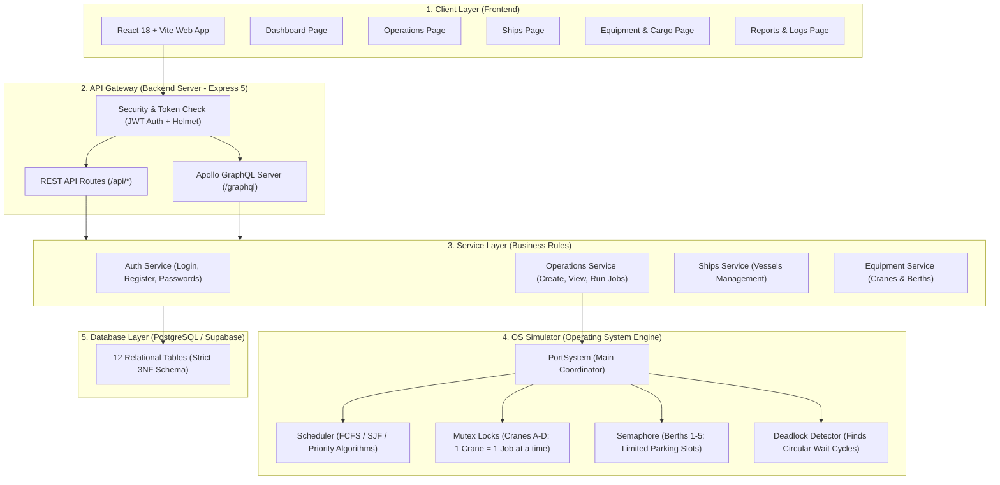
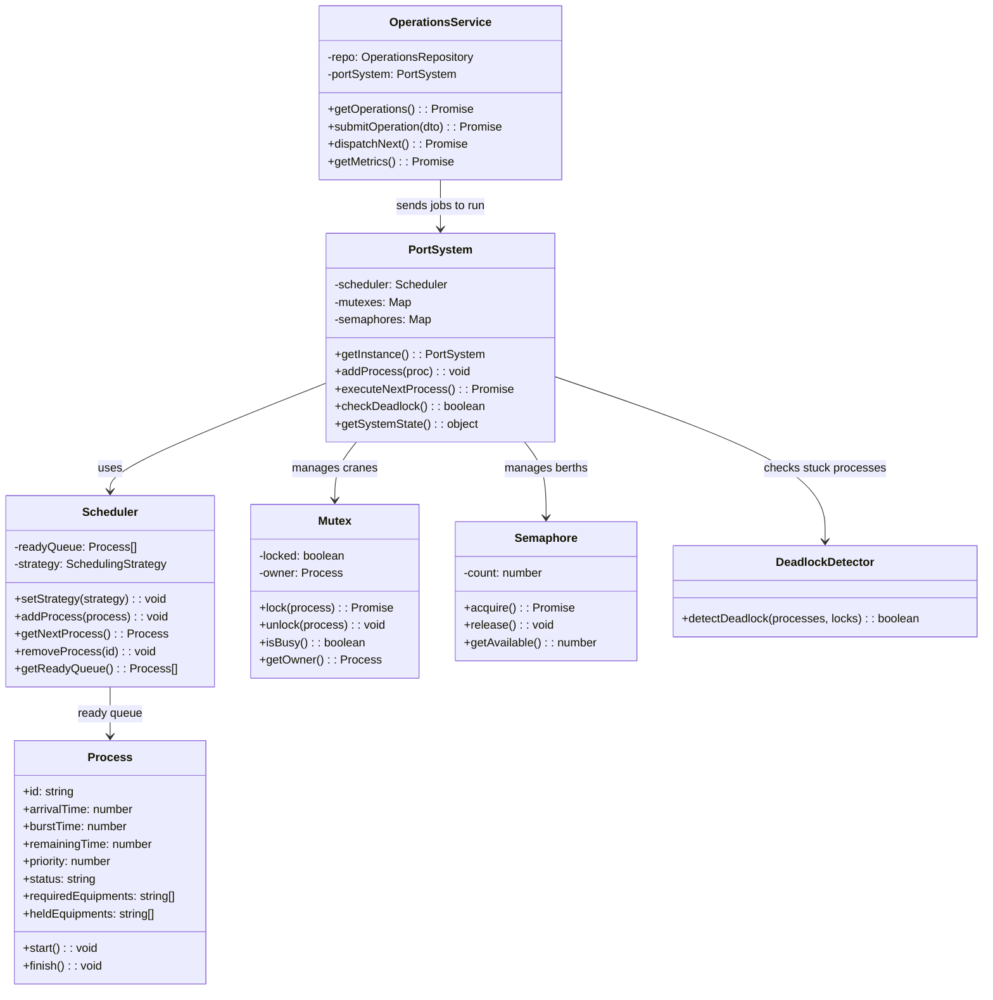
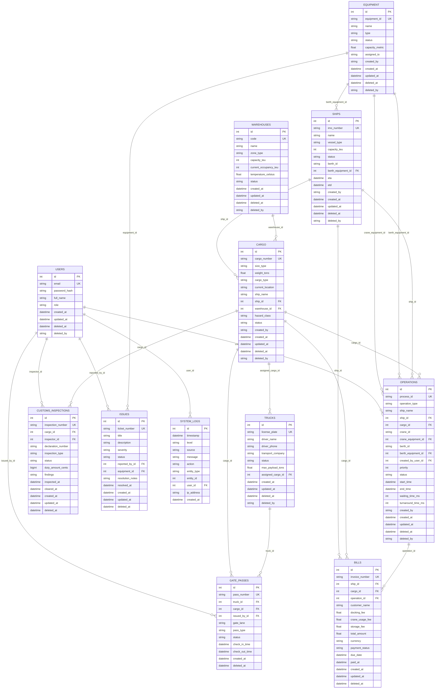
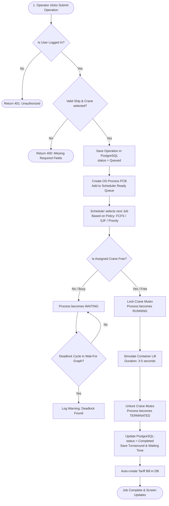
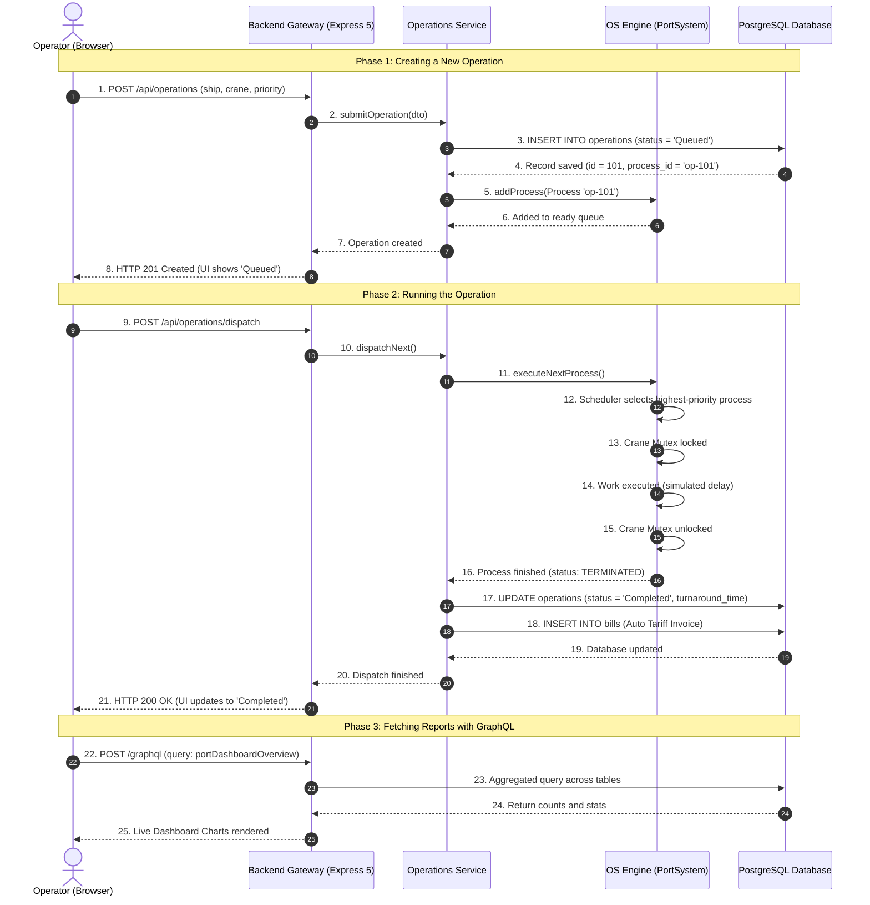

# PortFlow — All 5 System Diagrams (Simple English Guide)

This guide explains all 5 system diagrams for the PortFlow project in simple, clear English.
The diagrams use Mermaid format so you can see them directly inside your code editor or markdown viewer.

---

## 📁 Files in Your Project

You have all diagrams in two formats:
1. **Markdown File**: `folder/DIAGRAMS.md` (Press `Ctrl + Shift + V` in VS Code to see visual diagrams)
2. **Draw.io XML File**: `folder/diagrams.xml` (Open at https://app.diagrams.net to view and edit)

Database Schema References:
- SQL Schema: `backend/supabase/schema.sql`
- Prisma Schema: `backend/prisma/schema.prisma`

---

## 1. System Architecture Diagram

This diagram shows the 5 main parts of PortFlow and how they connect with each other.

### 📊 Diagram (Mermaid)

### 💡 Simple Explanation
1. **Client Layer (Frontend)**: The website built with React. Operators click buttons here to manage ships, cargo, and cranes.
2. **API Gateway (Backend Server)**: Listens for requests on port 10000. It checks user login tokens (JWT) and sends requests to either REST API or GraphQL.
3. **Service Layer**: Contains the business logic. It validates user data, checks permissions, and handles database queries.
4. **OS Simulator**: Treats port resources like computer parts. A crane is a lock (Mutex), berths are counting resources (Semaphore), and cargo loading is a Process run by a CPU Scheduler.
5. **Database Layer**: Stores all data safely in 12 PostgreSQL tables.

---

## 2. Class Diagram

This diagram shows the main TypeScript classes in the backend and how they work together.

### 📊 Diagram (Mermaid)

### 💡 Simple Explanation of Classes
- **`Process`**: Represents a single port job (e.g. unloading a container from a ship). It tracks process ID, arrival time, burst duration, priority, and state (`READY`, `RUNNING`, `TERMINATED`).
- **`Scheduler`**: The CPU scheduling engine that decides which job runs next using standard algorithms.
- **`SchedulingStrategy`**: Common interface that lets us swap algorithms at runtime without restarting the server.
- **`Mutex`**: A mutual-exclusion lock. Because a crane can only lift one container at a time, a process must lock the crane before use and unlock it when finished.
- **`Semaphore`**: A counting semaphore for berths. If 5 berths exist, it counts down when ships dock and counts up when they depart.
- **`DeadlockDetector`**: Builds a Wait-For Graph (WFG) and runs Depth-First Search (DFS) to detect circular resource wait cycles.
- **`PortSystem`**: The Singleton coordinator that binds the scheduler, locks, and berths into one unified OS engine.

### 🔗 Class Diagram Relationships Explained (Plain English)
1. **Implementation / Realization (`SchedulingStrategy <|.. Strategy`):**
   - `FCFSStrategy`, `SJFStrategy`, `PriorityStrategy`, and `RoundRobinStrategy` all implement the `SchedulingStrategy` interface.
   - *Meaning:* The `Scheduler` can switch between any algorithm at runtime instantly without touching the rest of the codebase.
2. **Composition (`PortSystem` owns `Scheduler`, `Mutex`, `Semaphore`, `DeadlockDetector`):**
   - `PortSystem` is the master controller that creates and holds the crane mutex map, the berth semaphore counter, and the deadlock detector.
3. **Aggregation / Queue (`Scheduler` holds `Process[]`):**
   - The `Scheduler` maintains an internal `readyQueue` array of waiting `Process` objects. Jobs enter the queue, get sorted by algorithm, and leave when executed.
4. **Dependency / Invocation (`OperationsService` calls `PortSystem`):**
   - The web API service (`OperationsService`) depends on `PortSystem`. When an operator clicks "Dispatch Next" in the browser, `OperationsService` delegates the work to `PortSystem.executeNextProcess()`.

---

## 3. Entity-Relationship (ER) Diagram

This diagram matches **`backend/supabase/schema.sql`** and **`backend/prisma/schema.prisma`** exactly.
It shows all **12 tables**, their columns, Primary Keys (`PK`), Foreign Keys (`FK`), and connections.

### 📊 Diagram (Mermaid)

### 💡 Simple Explanation of the 12 Tables
1. **`users`**: Authenticated staff (Terminal Operator, Admin, Customs Officer).
2. **`equipment`**: Physical infrastructure — Berths (parking slots) and Cranes (container lifting).
3. **`ships`**: Cargo vessels visiting the port, linked to assigned berths.
4. **`warehouses`**: Storage facilities (Cold Chain Reefer Storage and Dry Yard Storage).
5. **`cargo`**: Shipping container freight inventory with TEU sizes (20ft, 40ft) and tare weight.
6. **`operations`**: Central operational jobs (Ship + Crane + Berth + Priority + Status).
7. **`trucks`**: Ground logistics trucks transporting containers in and out of the port.
8. **`gate_passes`**: Security gate access passes for trucks entering through specific lanes.
9. **`customs_inspections`**: Legal customs compliance checks and duty tariff records.
10. **`bills`**: Automated financial invoices itemizing berth docking, crane usage, and storage fees.
11. **`issues`**: Mechanical incident tickets and breakdown alerts for faulty equipment.
12. **`system_logs`**: Immutable audit logs of all user actions and OS scheduling events.

### 🔗 Entity-Relationship (ER) Connections Explained (Plain English)
Every relationship in PortFlow connects tables with explicit Foreign Key (FK) rules (`ON DELETE SetNull` or `Cascade`):

1. **`users` (1) $\rightarrow$ (Many) `operations`, `gate_passes`, `customs_inspections`, `issues`, `system_logs`:**
   - *Meaning:* One user (operator, inspector, technician) can initiate multiple operations, issue multiple gate passes, clear multiple customs inspections, report multiple issues, or trigger multiple system logs.
2. **`equipment` (1) $\rightarrow$ (Many) `ships` (`berth_equipment_id`):**
   - *Meaning:* A physical Berth equipment can have multiple ships dock there over time (one ship at a time per berth).
3. **`equipment` (1) $\rightarrow$ (Many) `operations` (`crane_equipment_id` & `berth_equipment_id`):**
   - *Meaning:* A Quay Crane or Berth is used across multiple operations sequentially (protected by Mutex locks in real time).
4. **`ships` (1) $\rightarrow$ (Many) `cargo` (`ship_id`):**
   - *Meaning:* One container vessel carries multiple cargo containers on its manifest.
5. **`ships` (1) $\rightarrow$ (Many) `operations` (`ship_id`):**
   - *Meaning:* A single ship can have multiple loading and unloading jobs during its stay.
6. **`warehouses` (1) $\rightarrow$ (Many) `cargo` (`warehouse_id`):**
   - *Meaning:* One warehouse facility (e.g. Cold Chain CFS) stores many containers in its yard.
7. **`cargo` (1) $\rightarrow$ (Many) `operations`, `trucks`, `gate_passes`, `customs_inspections`, `bills`:**
   - *Meaning:* A container is moved by an operation, assigned to a truck, verified by a gate pass, scanned by customs, and charged storage fees on an invoice.
8. **`trucks` (1) $\rightarrow$ (Many) `gate_passes` (`truck_id`):**
   - *Meaning:* A drayage truck receives a new Gate Pass each time it checks in or checks out through the terminal security gate.
9. **`operations` (1) $\rightarrow$ (Many) `bills` (`operation_id`):**
   - *Meaning:* When an operation completes, an automated invoice is generated itemizing crane hours, turnaround time, and docking tariffs.

---

## 4. Flowchart (Step-by-Step Operation Lifecycle)

This diagram shows what happens when an operator submits a job.

### 📊 Diagram (Mermaid)

### 💡 Simple Explanation
1. **Submit**: The operator picks a ship, crane, and priority, then clicks Submit.
2. **Security**: The server checks the login token. If missing, it rejects the request.
3. **Database Save**: The job is stored in PostgreSQL with status `Queued`.
4. **Queue in OS**: A `Process` object is created and placed in the ready queue.
5. **Scheduler Choice**: The algorithm picks the next job (for example, shortest first or highest priority).
6. **Crane Lock Check**:
   - If the crane is busy: The job waits (`WAITING`), and the deadlock detector checks for issues.
   - If the crane is free: The crane is locked, and the job runs (`RUNNING`).
7. **Finish & Clean Up**: When done, the crane is unlocked, the database is updated to `Completed`, and an invoice is created.

---

## 5. Sequence Diagram (Request & Response Timeline)

This diagram shows how messages travel between the user, server, OS engine, and database.

### 📊 Diagram (Mermaid)

### 💡 Simple Explanation
1. **Submit**: The operator sends job details. The backend saves it as `Queued` in PostgreSQL and gives it to the in-memory OS scheduler.
2. **Dispatch**: When dispatch runs, the scheduler picks the best job, locks the crane, runs the job, releases the crane, and marks the job as `Completed` with total time recorded.
3. **GraphQL Reports**: When viewing reports, one single query gets ships, operations, and bills data together without refreshing the page.

---

## 🛠️ How to Open and Edit the Draw.io XML File

The multi-diagram Draw.io file is saved at:
`folder/diagrams.xml`

Steps to open it:
1. Open your browser and go to **https://app.diagrams.net**
2. Click **File** ➔ **Open From** ➔ **Device**
3. Select `folder/diagrams.xml` from your project folder.
4. You will see 5 bottom tabs:
   - Tab 1: `1. Architecture Diagram`
   - Tab 2: `2. Class Diagram`
   - Tab 3: `3. Entity-Relationship (ER) Diagram`
   - Tab 4: `4. Flowchart (Operation & OS Lifecycle)`
   - Tab 5: `5. Sequence Diagram`
5. You can edit any box or line, and export your diagrams as PNG or PDF via **File ➔ Export as**.
