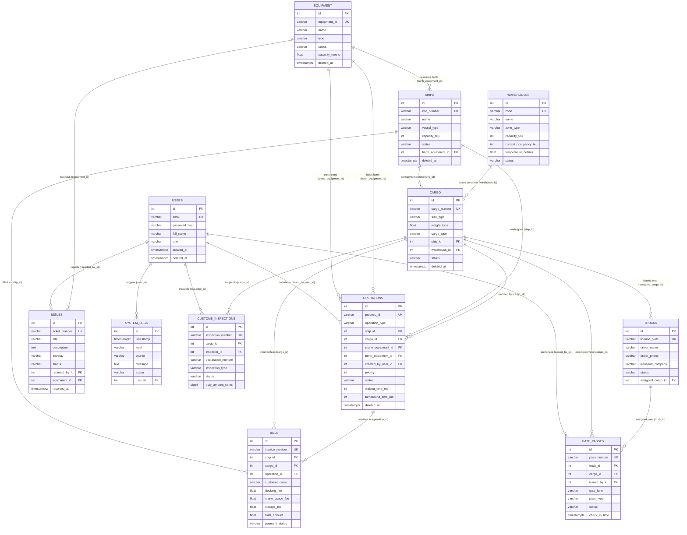
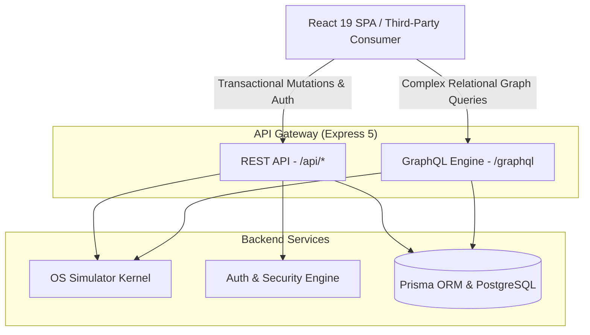

<div align="center">
  <h1>🚀 Phase 3: Enterprise Architecture, Schema & Analytics</h1>
  <p><strong>Full 12-Table Relational Model, PK & FK Connections, System Monitoring & Observability</strong></p>
</div>

---

## 🎯 1. Phase 3 Objectives Achieved
Phase 3 expands PortFlow into a complete enterprise Marine Terminal Operating System (TOS) and robust OS simulator platform by establishing:
1. **Full 12-Table 3NF Relational Model:** Primary Keys (PK) and Foreign Keys (FK) connecting Vessels, Cargo, Cranes/Berths, Operations, Drayage Trucks, Warehouses, Gate Passes, Customs Clearances, Tariff Invoices, Incident Issues, and System Logs.
2. **Strict Referential Integrity:** Foreign Key cascade/set-null constraints, unique identifiers (IMO numbers, container prefixes, invoice IDs), and check constraints.
3. **Observability & Analytics:** Real-time system log streaming, user action audit trails, and live relational multi-table JOIN latency benchmarks.
4. **Active Incident Support:** High-priority ticket reporting with database persistence.

---

## 🗺️ 2. Comprehensive Entity-Relationship (ER) Diagram



---

## 🔗 3. Relational Foreign Key (PK & FK) Architecture

| # | Entity / Table | Primary Key (PK) | Foreign Keys (FK) | Referenced Table & Action | Real-World & OS Simulator Domain Meaning |
|---|---|---|---|---|---|
| **1** | `users` | `id` (SERIAL) | None | N/A | Terminal Operators, Customs Officers, and System Administrators. |
| **2** | `equipment` | `id` (SERIAL) | None | N/A | Physical shared resources: Quay Cranes (Mutex) and Berths (Counting Semaphore). |
| **3** | `ships` | `id` (SERIAL) | `berth_equipment_id` | `equipment(id)` ON DELETE SET NULL | Marine vessel calling at port docked at a specific allocated Berth. |
| **4** | `warehouses` | `id` (SERIAL) | None | N/A | CFS storage yards and reefer cold chain facilities with capacity tracking. |
| **5** | `cargo` | `id` (SERIAL) | `ship_id`<br>`warehouse_id` | `ships(id)` ON DELETE SET NULL<br>`warehouses(id)` ON DELETE SET NULL | Container manifest originating from incoming ship and positioned in yard/warehouse. |
| **6** | `operations` | `id` (SERIAL) | `ship_id`<br>`cargo_id`<br>`crane_equipment_id`<br>`berth_equipment_id`<br>`created_by_user_id` | `ships(id)` ON DELETE SET NULL<br>`cargo(id)` ON DELETE SET NULL<br>`equipment(id)` ON DELETE SET NULL<br>`equipment(id)` ON DELETE SET NULL<br>`users(id)` ON DELETE SET NULL | PCB process scheduled via CPU Scheduler (FCFS/SJF) holding Crane Mutex and Berth Semaphore. |
| **7** | `trucks` | `id` (SERIAL) | `assigned_cargo_id` | `cargo(id)` ON DELETE SET NULL | Land-based transport drayage fleet carrying container manifests to/from terminal. |
| **8** | `gate_passes` | `id` (SERIAL) | `truck_id`<br>`cargo_id`<br>`issued_by_id` | `trucks(id)` ON DELETE CASCADE<br>`cargo(id)` ON DELETE SET NULL<br>`users(id)` ON DELETE SET NULL | Security perimeter gate clearance authorizing truck and container entry/exit. |
| **9** | `customs_inspections` | `id` (SERIAL) | `cargo_id`<br>`inspector_id` | `cargo(id)` ON DELETE CASCADE<br>`users(id)` ON DELETE SET NULL | Regulatory customs inspection (X-Ray/Quarantine) with tariff duties and clearance holds. |
| **10** | `bills` | `id` (SERIAL) | `ship_id`<br>`cargo_id`<br>`operation_id` | `ships(id)` ON DELETE SET NULL<br>`cargo(id)` ON DELETE SET NULL<br>`operations(id)` ON DELETE SET NULL | Automated tariff invoicing based on crane burst times, berth hours, and storage fees. |
| **11** | `issues` | `id` (SERIAL) | `reported_by_id`<br>`equipment_id` | `users(id)` ON DELETE SET NULL<br>`equipment(id)` ON DELETE SET NULL | Operational incident reporting and hardware equipment breakdown ticketing. |
| **12** | `system_logs` | `id` (SERIAL) | `user_id` | `users(id)` ON DELETE SET NULL | Observability runtime event logging and security audit mutation trails. |

---

## ⚡ 4. Relational JOIN Query Demonstration

The multi-table schema allows complex analytical queries with index-accelerated performance:

```sql
-- Comprehensive Port Operational Report (5-Table Relational JOIN)
SELECT 
    ops.process_id AS pcb_id,
    ops.operation_type,
    ops.status AS pcb_state,
    s.name AS vessel_name,
    s.imo_number,
    c.cargo_number,
    c.weight_tons,
    crane.name AS assigned_crane_mutex,
    berth.name AS assigned_berth_semaphore,
    u.full_name AS operator_name
FROM operations ops
INNER JOIN ships s ON ops.ship_id = s.id
LEFT JOIN cargo c ON ops.cargo_id = c.id
LEFT JOIN equipment crane ON ops.crane_equipment_id = crane.id
LEFT JOIN equipment berth ON ops.berth_equipment_id = berth.id
LEFT JOIN users u ON ops.created_by_user_id = u.id
WHERE ops.deleted_at IS NULL
ORDER BY ops.priority DESC, ops.created_at ASC;
```

---

## 🛡️ 5. Production Normalization & Integrity
1. **1NF:** Atomic attributes, unique primary keys, and no repeating groups.
2. **2NF:** All non-key attributes fully functionally dependent on the entire primary key.
3. **3NF:** No transitive functional dependencies. Vessel attributes remain in `ships`, equipment in `equipment`, and tariff rates in `bills`.
4. **Soft-Delete Architecture:** Two-phase deletion preserves relational integrity without triggering orphan records or broken foreign key errors.

---

## 🌐 6. Dual API Architecture: REST & GraphQL Coexistence

PortFlow implements a pragmatic dual-protocol API gateway where both REST and GraphQL are leveraged where they naturally excel:



### Domain Allocation Matrix

| Architectural Concern | Protocol Chosen | Primary Endpoint | Rationale |
|:---|:---:|:---|:---|
| **Authentication & Password Recovery** | **REST** | `POST /api/auth/*` | Standard JWT headers, cookie transport, bcrypt hashing, and rate-limiting on sensitive auth routes. |
| **OS Simulation State Actions** | **REST** | `POST /api/operations/dispatch`<br>`PUT /api/os/algorithm` | Atomic, imperative command triggers modifying in-memory CPU queues and Mutex lock states. |
| **Two-Phase Soft-Delete & Trash Recovery** | **REST** | `POST /api/trash/restore/*`<br>`DELETE /api/trash/empty` | Strict HTTP verb semantics (`DELETE`, `POST`) ensuring predictable cache invalidation and safety. |
| **Nested Relational Data Graphs** | **GraphQL** | `POST /graphql` | Eliminates the N+1 REST waterfall. Fetches `Ship` &rarr; `assignedBerth` &rarr; `cargoManifests` &rarr; `warehouses` in a single request. |
| **Composite Dashboard Telemetry** | **GraphQL** | `query { portDashboardOverview { ... } }` | Fetches aggregate table counts, active process states, and resource availability without over/under-fetching. |
| **Flexible Reporting & Selective Queries** | **GraphQL** | `query { ships { ... } cargo { ... } }` | Allows UI components to query only the exact fields they render, minimizing payload size. |

